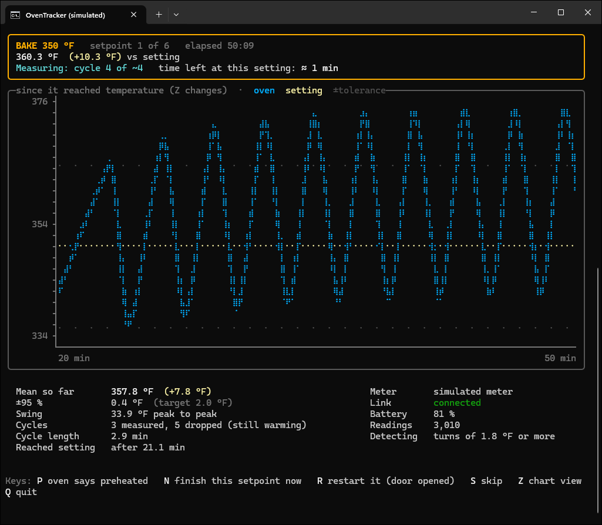
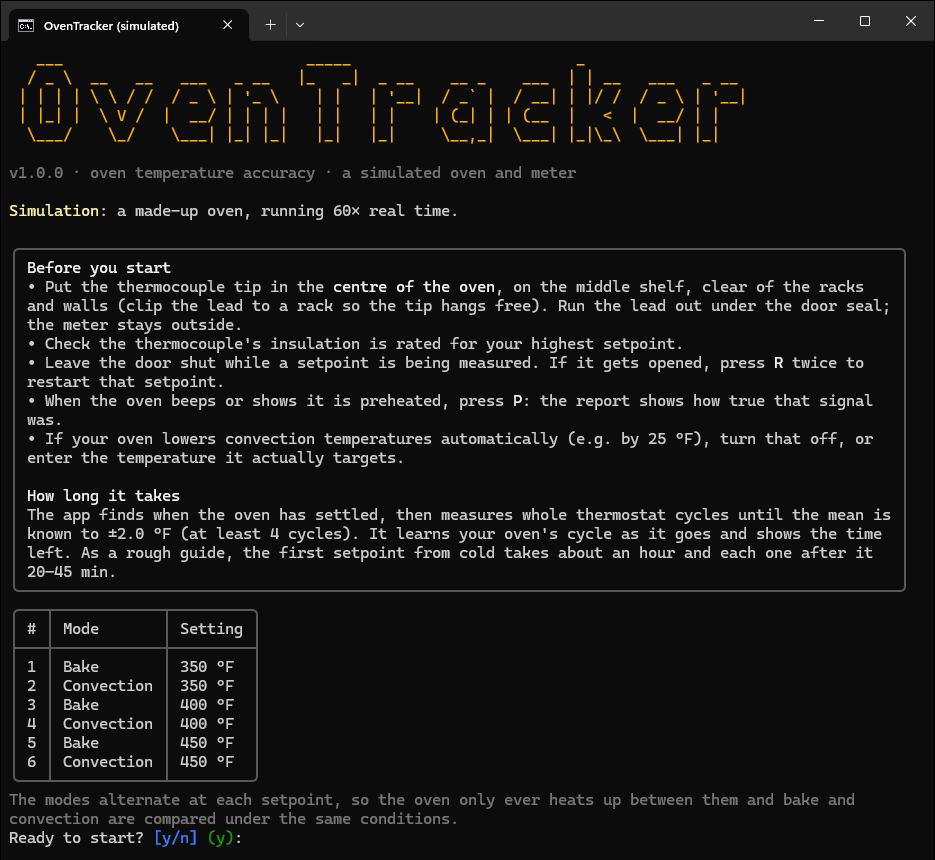

# OvenTracker

Checks how accurate an oven's temperature setting really is, in **bake** and **convection**, using a
Keysight (Agilent) **U1253B** multimeter with a type K thermocouple, read over Bluetooth through a
**U1177A** IR-to-Bluetooth adapter. A .NET 11 console app with a live
[Spectre.Console](https://spectreconsole.net) display.

For each setpoint it works out by itself when the oven has settled and how long it has to keep
measuring. It then reports the true average temperature, how far that is from the setting, how much the
thermostat swings, and how bake and convection differ.



*The live display at bake 350 °F, four cycles in. (These screenshots are from the built-in simulator, `--simulate`.)*

## What you need

- U1253B with a type K thermocouple in the temperature input, dial on temperature (°C or °F; the app
  reads whichever the meter shows).
- U1177A clipped to the meter's IR port, switched on and paired in Windows Bluetooth settings. Pairing
  adds two "Standard Serial over Bluetooth link" COM ports. The app uses the **outgoing** one (the one
  with the adapter's address) and finds it by itself.
- The .NET 11 runtime (or build with `-SelfContained`).

## Use

```powershell
OvenTracker.exe                       # asks for the unit, modes and setpoints, then guides you
OvenTracker.exe run --unit F --modes bake,convection --setpoints 350,400,450
OvenTracker.exe meters --probe        # which meters can it see, and which answers?
OvenTracker.exe run --meter u1253b --resource COM5   # a particular meter, without searching
OvenTracker.exe analyze "$HOME\Documents\OvenTracker\2026-11-20 1400" --tolerance 10
OvenTracker.exe run --simulate --speed 120   # try it all without the meter or the oven
```

1. Hang the thermocouple tip in the centre of the oven, clear of racks and walls, and run the lead out
   under the door seal. Check its insulation is rated for your highest setpoint.
2. For each setpoint the app asks you to set the oven (e.g. *BAKE 350 °F*) and start it. Then leave the
   door shut and watch.
3. When the oven says it has preheated, press **P**. The report shows how true that signal was.
4. When a setpoint is done the meter beeps, and the app shows the result and asks for the next one.



By default the modes alternate at each setpoint (bake 350, convection 350, bake 400, ...). The oven
then only ever heats up between setpoints, and bake and convection are compared under the same
conditions. `--grouped` does all of bake first.

Keys while tracking: **P** preheat signal · **N N** finish this setpoint now · **R R** restart it (if
the door was opened) · **S S** skip · **Z** chart view · **Q Q** quit and write the report.
Ctrl+C also stops cleanly and writes the report.

## How it decides how long to track

An oven's thermostat switches the element on and off, so the temperature cycles around a mean, typically
every few minutes. That mean, not any single reading, is what the setting should be. For each setpoint:

1. **Heating**, until the first turning point. The first peak is the overshoot.
2. **Settling.** The first cycle after the overshoot isn't used.
3. **Measuring.** Each full cycle (trough to trough) gives one time-weighted mean, an independent sample
   of where the thermostat really holds. While the cycle means still trend (the walls and racks are
   still soaking up heat), the oldest cycle is dropped. The trend test looks at least 30 minutes ahead,
   so a slow drift isn't missed.
4. **Done** once there are at least 4 cycles (`--min-cycles`) and the 95 % confidence interval of their
   mean is within ±2 °F / ±1 °C (`--precision`).

From the spread of the cycle means so far, it calculates how many cycles that precision needs. Times
your oven's own cycle length, that gives the time left on screen. A steady oven finishes in 4 cycles; a
noisy one takes more. An oven that holds temperature without a visible cycle is measured in 3-minute
blocks instead. Nothing runs past `--max-minutes` (120 by default), and the report says if a setpoint
stopped there.

Turning points are found with a hysteresis set from the measured noise (at least 1 °C), so sensor noise
never counts as a cycle.

## Output

At the end, the app shows the results for every setpoint and what it found:


Each run saves to `Documents\OvenTracker\<date time>\` (or `--out`):

- `report.md`: findings, a table per setpoint, bake against convection, preheat signal accuracy, how
  long each setpoint needed, and how far to trust it.
- `results.json`: the same numbers, machine-readable (°C).
- `readings.csv`: every reading as it arrived, flushed line by line, with the events needed to replay
  the analysis. `analyze` re-runs it, for example with a different tolerance.

A setpoint is judged **Accurate** when its mean and its ±95 % interval are within the tolerance (±15 °F /
±8 °C by default, `--tolerance`), **Out of tolerance** when they are clearly outside it, and
**Borderline** in between. The thermocouple's own accuracy comes on top of the ±95 % figure, and the
report spells that out.

[Reading the results and adjusting the oven](docs/adjusting-the-oven.md) explains each column, when an
offset is worth correcting, and how to enter the correction on a GE Profile PHS925ST1SS.

## Other meters

Each kind of meter has a driver in `src/OvenTracker/Meter`. Two come with the app:

| `--meter` | What it is | `--resource` |
| --- | --- | --- |
| `u1253b` (the default) | A Keysight U1253B (or another U1250-series meter) through a U1177A Bluetooth adapter or a U1173 cable | A serial port, e.g. `COM5`. Left out, the app tries the port that worked last time, then each outgoing Bluetooth port. |
| `simulated` | A made-up oven and meter. `--simulate` is short for `--meter simulated`. | Not used. |

Without `--meter` the app uses the meter that answered last time, or the U1253B. `oventracker meters` lists what
each driver can see. `--probe` asks each likely place what is there, and `--all` asks every place. (`ports`
and `--port` still work, as the names they had when there was only the U1253B.)

To add a meter, for example a bench DMM with a thermocouple input over VISA:

1. Implement `ITemperatureMeter` (`Meter/Meter.cs`). Only `Location`, `Connect`, `Disconnect` and `Read` are
   required. `Read` returns the temperature in °C, or `Overload` for an open probe. Also implement any of these
   the meter can do; the app does without the ones it can't:
   - `ReadConfig` / `LastConfig`: what the meter is set to, and the sensor (`Sensor.Thermocouple("K")`). The
     report uses the sensor for its accuracy section.
   - `ReadBatteryPercent`
   - `Beep`
2. Implement `IMeterDriver` (`Meter/MeterDriver.cs`): its `--meter` name, how to find the meter (`Open`, `Discover`,
   `Probe`), what `--resource` means for it, and what to tell people when it can't find the meter.
3. Add it to `MeterDrivers.All`.

`U1253BDriver` and `SimulatedDriver` are the examples. Each run records the driver, the meter's identity and the
sensor in `session.json` and `results.json`.

## Protocol notes (U1253B)

The U1250 series talks at 9600 baud 8N1 through the U1177A: commands end in LF and replies in CR LF. The
app uses `*IDN?`, `CONF?` (temperature reads `"TEMP:K CEL"` or `"TEMP:K FAR"`), `FETC?` (±9.9E+37 means
an open thermocouple), `SYST:BATT?` and `SYST:BEEP`. It ignores the meter's own event lines (`*0`…`*7`
when the dial moves, `*L` for a button). It re-checks `CONF?` every few readings, so turning the dial
away from temperature is noticed and those readings aren't used. If the Bluetooth link drops, the app
reconnects and carries on.

## Build

```powershell
./build.ps1 -SignScript C:\path\to\Sign-Files.ps1   # test, publish, sign, zip
./build.ps1 -SelfContained                           # unsigned, includes the .NET runtime
```

`build.ps1` runs the tests, publishes for win-x64 into `artifacts\publish` and zips it into
`artifacts\OvenTracker-<version>-win-x64.zip`. Given a signing script (`-SignScript`, or the
`OVENTRACKER_SIGN_SCRIPT` environment variable), it Authenticode-signs OvenTracker's own `OvenTracker.exe`
and `OvenTracker.dll` with Azure Artifact Signing before zipping. It then fails unless both are validly
signed. Other publishers' DLLs are left alone. The signing account and tools stay outside the repository.
Without a script the build still works, unsigned, with a warning.

## License

[MIT](LICENSE)
