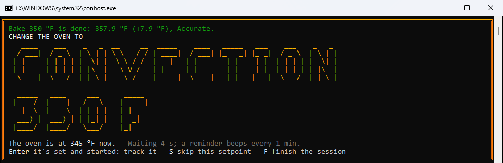
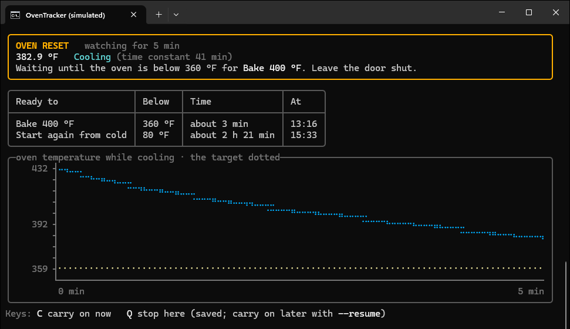
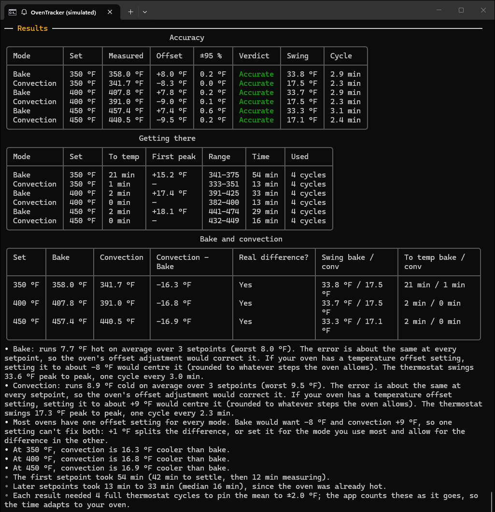

# OvenTracker

[](https://github.com/TGoodhew/OvenTracker/actions/workflows/ci.yml)

Checks how accurate an oven's temperature setting really is, in **bake** and **convection**, using a
Keysight (Agilent) **U1253B** multimeter with a type K thermocouple, read over Bluetooth through a
**U1177A** IR-to-Bluetooth adapter. A .NET 11 console app for **Windows and Linux**, with a live
[Spectre.Console](https://spectreconsole.net) display.

For each setpoint it works out by itself when the oven has settled and how long it has to keep
measuring. It then reports the true average temperature, how far that is from the setting, how much the
thermostat swings, and how bake and convection differ.


*The live display at bake 350 °F, four cycles in. (These screenshots are from the built-in simulator, `--simulate`.)*

## What you need

- U1253B with a type K thermocouple in the temperature input, dial on temperature (°C or °F; the app
  reads whichever the meter shows).
- **The meter's auto power-off turned off.** The U1253B switches itself off after 10 minutes by default,
  and reading it over Bluetooth doesn't keep it on, so it would switch off in the middle of every setpoint.
  To turn it off: hold the button that steps through the functions at the dial's position (button 4 in the
  guide's keypad table) for more than a second to enter Setup, go to **APO** with the arrow buttons, press
  **Hz**, set every digit to zero (OFF), press **Hz** to save, and hold the button again to leave Setup
  (User's and Service Guide, pp. 110 and 126–127). The app reminds you before a run until you say it's off.
- U1177A clipped to the meter's IR port, switched on and paired with the computer:
  - **Windows:** pair it in Bluetooth settings. Pairing adds two "Standard Serial over Bluetooth link" COM
    ports. The app uses the **outgoing** one (the one with the adapter's address) and finds it by itself.
  - **Linux:** pair it and bind it to `/dev/rfcomm0` (see [Linux](#linux)). The app finds RFCOMM devices by
    itself.
- OvenTracker from the [Releases](https://github.com/TGoodhew/OvenTracker/releases) page. The
  *self-contained* packages need nothing else; the others need the
  [.NET 11 runtime](https://dotnet.microsoft.com/download).

## Linux

OvenTracker runs on Linux on x64 and 64-bit ARM (a Raspberry Pi 4 or 5 makes a handy oven-side logger).
Unpack the package and run it from a terminal:

```sh
mkdir ~/oventracker && tar -xzf OvenTracker-*-linux-x64-self-contained.tar.gz -C ~/oventracker
~/oventracker/OvenTracker
```

The U1177A is a Bluetooth serial (SPP) device. Pair it once, then bind it to a serial device:

```sh
bluetoothctl                      # then: scan on, pair <address>, trust <address>, quit
sudo rfcomm bind 0 <address>      # makes /dev/rfcomm0 (rfcomm is in the bluez package; some
                                  # distributions put it in bluez-deprecated-tools)
sudo usermod -aG dialout $USER    # serial devices belong to the dialout group; log in again after
```

The binding doesn't survive a restart, so run `rfcomm bind` again after one. A U1173 IR-USB cable shows up
as `/dev/ttyUSB0` instead; give it with `--resource /dev/ttyUSB0`. `OvenTracker meters` lists the serial
devices it can see.

On Linux, runs are saved to `~/Documents/OvenTracker` (or `~/OvenTracker` if there is no `~/Documents`).
The app remembers the last meter in `~/.config/OvenTracker`.

## Use

On Linux, the program is `./OvenTracker`, and the resource is a device such as `/dev/rfcomm0`.


```powershell
OvenTracker.exe                       # asks for the unit, modes and setpoints, then guides you
OvenTracker.exe run --unit F --modes bake,convection --setpoints 350,400,450
OvenTracker.exe meters --probe        # which meters can it see, and which answers?
OvenTracker.exe run --meter u1253b --resource COM5   # a particular meter, without searching
OvenTracker.exe analyze "$HOME\Documents\OvenTracker\2026-11-20 1400" --tolerance 10
OvenTracker.exe analyze "<earlier run>" "<later run>" --favour 350   # runs together; right at 350 °F
OvenTracker.exe run --simulate --speed 120   # try it all without the meter or the oven
```

1. Hang the thermocouple tip in the centre of the oven, clear of racks and walls, and run the lead out
   under the door seal. Check its insulation is rated for your highest setpoint.
2. For each setpoint the app stops and shows the setting in large letters (e.g. *BAKE 350 °F*). Set the oven
   and start it, then press **Enter**. Leave the door shut and watch.
3. When the oven says it has preheated, press **P**. The report shows how true that signal was.
4. When a setpoint is done, the meter beeps, the app shows the result, and it stops again with the next
   setting: *CHANGE THE OVEN TO CONVECTION 350 °F*. Until you press a key, it reminds you every minute (the
   meter beeps and the PC's bell rings; `--remind <minutes>`, or `--remind 0` for no repeats). It waits like
   this with a real meter even with `--yes`, since nothing else changes the oven. At the end, it asks you
   to turn the oven off the same way.



If the oven doesn't head for the new setting within 6 minutes, the app beeps and asks whether you changed
it. For example, the setting was raised from 350 to 400 °F, but the oven is still cycling around 350 °F. If
you hadn't, change it and press **R R** to restart that setpoint. A change of mode at the same temperature
can't be seen this way, so check the mode on the prompt.


By default the modes alternate at each setpoint (bake 350, convection 350, bake 400, ...). The oven
then only ever heats up between setpoints, and bake and convection are compared under the same
conditions. `--grouped` does all of bake first.

Keys while tracking: **P** preheat signal · **N N** finish this setpoint now · **R R** restart it (if
the door was opened) · **S S** skip · **Z** chart view · **Q Q** quit and write the report.
Ctrl+C also stops cleanly and writes the report.

If the meter stops answering for 30 s (most often its auto power-off), the live display says so in red,
with how to wake it ("press any button on the meter, or turn the dial"), and the PC beeps. Tracking
carries on as soon as readings come back. The gap is recorded in `readings.csv`, and the report notes any
setpoint with a gap of a minute or more.

### Splitting a session (oven reset)

A full session takes hours, but it doesn't have to be done in one go. Stop after any setpoint (*Finish the
session*, or **Q Q**). The report covers what's done, and the app prints the command to carry on. Use the
oven, then leave the probe in it and resume:

```powershell
OvenTracker.exe run --resume "$HOME\Documents\OvenTracker\2026-11-20 1400"
```

It measures the setpoints that weren't finished, adds them to the same folder, and writes one report over
both sittings. A run that was cut off (closed, crashed, or the PC slept) can be resumed the same way.

If the oven is still hot, the app first waits for it to cool, so the next setpoint starts the way it would
have in one go: from just above the setpoint before it (or from cold, for the first). While it waits, it
shows the oven cooling and predicts when it will be ready. It learns how fast your oven cools as it goes,
and also predicts when the oven will be cold enough to start a whole session again. It notices if the door
is opened, or if the oven is turned back on, and beeps when it's ready. Press **C** to carry on early.



Setpoints measured after a break are marked *after a reset* in the report. Their mean is as good as any
other, but their *To temp* and *First peak* aren't comparable with setpoints run straight on. The app knows
room temperature from the probe's first reading with the oven cold; if the oven is hot when you start, give
it with `--ambient 70`. Between setpoints, too, the app offers to wait whenever the oven is hotter than the
next setpoint should start from.

## How it decides how long to track

An oven's thermostat switches the element on and off, so the temperature cycles around a mean, typically
every few minutes. That mean, not any single reading, is what the setting should be. For each setpoint:

1. **Heating**, until the first turning point. The first peak is the overshoot.
2. **Settling.** The first cycle after the overshoot isn't used.
3. **Measuring.** Each full cycle (trough to trough) gives one time-weighted mean, an independent sample
   of where the thermostat really holds. While the cycle means still trend (the walls and racks are
   still soaking up heat), the oldest cycle is dropped. The trend test looks at least 30 minutes ahead,
   so a slow drift isn't missed.
4. **Done** once there are at least 4 cycles (`--min-cycles`) and the 95 % confidence interval of their
   mean is within ±2 °F / ±1 °C (`--precision`).

From the spread of the cycle means so far, it calculates how many cycles that precision needs. Times
your oven's own cycle length, that gives the time left on screen. A steady oven finishes in 4 cycles; a
noisy one takes more. An oven that holds temperature without a visible cycle is measured in 3-minute
blocks instead. Nothing runs past `--max-minutes` (120 by default), and the report says if a setpoint
stopped there.

Turning points are found with a hysteresis set from the measured noise (at least 1 °C), so sensor noise
never counts as a cycle.

## Output

At the end, the app shows the results for every setpoint and what it found:



Each run saves to `Documents\OvenTracker\<date time>\` (on Linux, `~/Documents/OvenTracker/<date time>/`),
or to `--out`:

- `report.md`: findings, a table per setpoint, the best thermostat adjustment (and what to set where it
  falls short), bake against convection, preheat signal accuracy, how long each setpoint needed, and how
  far to trust it.
- `results.json`: the same numbers, machine-readable (°C).
- `readings.csv`: every reading as it arrived, flushed line by line, with the events needed to replay
  the analysis. `analyze` re-runs it, for example with a different tolerance.

A setpoint is judged **Accurate** when its mean and its ±95 % interval are within the tolerance (±15 °F /
±8 °C by default, `--tolerance`), **Out of tolerance** when they are clearly outside it, and
**Borderline** in between. The thermocouple's own accuracy comes on top of the ±95 % figure, and the
report spells that out.

[Reading the results and adjusting the oven](docs/adjusting-the-oven.md) explains each column, when an
offset is worth correcting, and how to enter the correction on a GE Profile PHS925ST1SS.

The **best adjustment** is the oven thermostat setting that fits all the setpoints measured best, on the
oven's own steps (1 °F, up to ±35 °F, by default). Tell the app the oven's current adjustment (`run` asks,
or `--adjustment`), and the report says what to set it to. When the error changes with temperature, no
single setting fixes it all, so the report also shows what's left at each setpoint and what to set to make
up for it. `--objective minimax` keeps the worst setpoint as close as it can, and `--favour 350` makes the
oven right at 350 °F. Runs of the same setpoints at two different adjustments, analysed together, measure
how far the adjustment really moves the oven. [How the oven's control responds to its
adjustment](docs/oven-control-model.md) explains the method.

## Other meters

Each kind of meter has a driver in `src/OvenTracker/Meter`. Two come with the app:

| `--meter` | What it is | `--resource` |
| --- | --- | --- |
| `u1253b` (the default) | A Keysight U1253B (or another U1250-series meter) through a U1177A Bluetooth adapter or a U1173 cable | A serial port: `COM5` on Windows, `/dev/rfcomm0` on Linux. Left out, the app tries the port that worked last time, then each Bluetooth link. |
| `simulated` | A made-up oven and meter. `--simulate` is short for `--meter simulated`. | Not used. |

Without `--meter` the app uses the meter that answered last time, or the U1253B. `oventracker meters` lists what
each driver can see. `--probe` asks each likely place what is there, and `--all` asks every place. (`ports`
and `--port` still work, as the names they had when there was only the U1253B.)

To add a meter, for example a bench DMM with a thermocouple input, implement `ITemperatureMeter` and
`IMeterDriver` and list the driver in `MeterDrivers.All`. Only four members are required; the rest (the
sensor, battery, beep, and the meter's auto power-off setting) are optional. A driver can also declare that
its meter switches itself off, with the steps to turn that off, and the app then warns before a run.
[Adding a meter](docs/adding-a-meter.md) explains every member, with a sketch of a SCPI bench-meter driver.
`U1253BDriver` and `SimulatedDriver` are the worked examples.

## Protocol notes (U1253B)

The U1250 series talks at 9600 baud 8N1 through the U1177A: commands end in LF and replies in CR LF. The
app uses `*IDN?`, `CONF?` (temperature reads `"TEMP:K CEL"` or `"TEMP:K FAR"`), `FETC?` (±9.9E+37 means
an open thermocouple), `SYST:BATT?` and `SYST:BEEP`. It ignores the meter's own event lines (`*0`…`*7`
when the dial moves, `*L` for a button). It re-checks `CONF?` every few readings, so turning the dial
away from temperature is noticed and those readings aren't used. If the Bluetooth link drops, the app
reconnects and carries on.

## Build

One codebase builds for every system. `build.ps1` needs PowerShell 7 and runs on Windows or Linux:

```powershell
./build.ps1 -SignScript C:\path\to\Sign-Files.ps1         # Windows: test, publish, sign, zip
./build.ps1 -SelfContained                                # this system, with the .NET runtime included
./build.ps1 -Runtime linux-x64,linux-arm64 -SkipTests     # Linux packages (build them on Linux)
```

`build.ps1` runs the tests, then publishes each runtime (by default the one you're on) into
`artifacts/publish/<runtime>`. It packs Windows into `artifacts/OvenTracker-<version>-win-x64.zip`, and
Linux into `.tar.gz`, which keeps the program's executable bit. For Windows, given a signing script
(`-SignScript`, or the `OVENTRACKER_SIGN_SCRIPT` environment variable), it Authenticode-signs OvenTracker's
own `OvenTracker.exe` and `OvenTracker.dll` with Azure Artifact Signing before packing, then fails unless
both are validly signed. Other publishers' DLLs are left alone. The signing account and tools stay outside
the repository. Without a script the build still works, unsigned, with a warning.

The code is the same on both systems. What differs is kept behind `OperatingSystem` checks: finding serial
ports (WMI on Windows; `/dev` and sysfs on Linux), how port names compare, and where runs and settings are
saved.

**CI** ([ci.yml](.github/workflows/ci.yml)) builds and tests on Windows and Linux for every push and pull
request. On Linux it also publishes the app and runs a whole simulated session in a terminal.
**Releases** ([release.yml](.github/workflows/release.yml)) build each package on its own system (Windows,
Linux x64 and Linux ARM64), sign the Windows programs, and publish them with a `SHA256SUMS` file.
[docs/releasing.md](docs/releasing.md) explains how to make a release and how signing is set up.

## License

[MIT](LICENSE)
